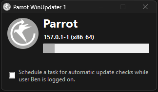

[Getting started](#getting-started) • [Settings](#settings) • [Issues](#issues)


# Parrot WinUpdater

An easy way to keep Parrot Browser up to date on Windows.



## Getting started

### Parrot Setup

- During installation, you can choose to install Parrot WinUpdater alongside Parrot Browser.
- On first launch, WinUpdater copies itself to `%AppData%\Parrot\WinUpdater\`. This allows it to update itself without administrator privileges.
- Alternatively, you can download and extract the latest `Parrot-WinUpdater_x.x.x.zip` from the [Parrot Browser releases](https://github.com/BentendoYT/Parrot-Browser/releases), then run `Parrot-WinUpdater.exe`.

### Parrot Portable

- The portable version of Parrot Browser can include WinUpdater in its package.
- When you launch `Parrot-Portable.exe`, WinUpdater automatically checks for updates once a day.
- To perform update checks manually instead, rename WinUpdater to something like `Parrot-ManualUpdater.exe` and run it whenever needed.

### Scheduled updates

- During Parrot Browser installation, select **Schedule Automatic Updates** to configure scheduled update checks.
- Alternatively, open Parrot WinUpdater and enable **Schedule a task for automatic update checks**. This requires administrator permissions.
- The scheduled task runs while the current Windows user is logged in. It checks for updates one minute after login and every four hours afterwards.
- If your account has administrator permissions, updates are installed automatically. Otherwise, the update is downloaded and you are asked to start the installation manually.
- If Parrot Browser is running, the update waits until you close the browser.

## Settings

### Configuration and log file

WinUpdater needs permission to write to `Parrot-WinUpdater.ini` in its own directory. If it cannot, it copies itself to `%AppData%\Parrot\WinUpdater\` and runs from there.

The INI file contains a `[Log]` section with information about the latest update check and update operation.

### Self-updating

WinUpdater updates itself automatically.

To disable this, set `UpdateSelf` to `0` under `[Settings]`:

```ini
[Settings]
UpdateSelf=0
```

### Custom working directory

If WinUpdater cannot use the default `%Temp%` directory, you can specify another working directory with `WorkDir`:

```ini
[Settings]
WorkDir=D:\Temp
```

To use the directory containing `Parrot-WinUpdater.exe`, set `WorkDir=.`. Relative subdirectories are also supported, such as `WorkDir=.\Temp`.

## Issues

### Anti-cheat software

Some anti-cheat software may incorrectly flag WinUpdater because it is built with AutoHotkey, which can also be used to create game cheats.

If this happens, you can adjust the scheduled task:

1. Open **Task Scheduler** from the Windows Start menu.
2. Find the Parrot WinUpdater task in the Task Scheduler Library.
3. Open the **Triggers** tab.
4. Remove the recurring trigger and keep the login trigger.

Alternatively, you can manage the scheduled task using these commands:

```powershell
Parrot-WinUpdater.exe /RemoveTask
Parrot-WinUpdater.exe /CreateTask
```

### Signature verification

WinUpdater verifies its own signature and the downloaded setup file or portable executable.

If verification fails, make sure PowerShell has internet access. It needs to retrieve certificate revocation information.

If signature verification is not possible on your system, you can disable it and rely on file hash checks instead:

```ini
[Settings]
NoSigChecks=1
```

Disabling signature checks reduces the level of verification performed by WinUpdater.

### Server certificate revocation

Windows may display a certificate revocation warning if revocation information cannot be retrieved.

This can happen when **Check for server certificate revocation** is enabled in Windows Internet Options.

To let WinUpdater continue automatically when this occurs, set:

```ini
[Settings]
IgnoreCrlErrors=1
```

### Asking for help

If you encounter a problem, check the existing reports or open a new issue:

- [Parrot WinUpdater Issues](https://github.com/BentendoYT/Parrot-winupdater/issues)
- [Parrot Browser Issues](https://github.com/BentendoYT/Parrot-Browser/issues)

## License

Parrot WinUpdater is distributed under the GNU General Public License v3.0. See [LICENSE](./LICENSE) for details.

Copyright © 2026 BentendoYT.
